# Pata Commands

Pata Commands 是面向 Windows 开发者的轻量级、本地优先命令工具。主流程已经扩展为 **复制命令 → `Ctrl+Shift+V` 唤出 → 一次点击保存 → AI 自动生成中文注释**：快捷面板同时承担剪贴板历史浏览、命令检索、永久收藏和注释查看入口。v0.2.0 起增加独立的**提示词库**，用于保存 ChatGPT、Codex、Claude、Gemini 等 AI 工具中的长文本提示词，与命令库数据隔离但共享搜索、目录、标签、收藏和快捷复制体验。

当前版本 **v0.2.0**。

- GitHub 仓库：https://github.com/605521553/cmdLoad
- 下载最新安装包：https://github.com/605521553/cmdLoad/releases/latest
- 在线更新清单：https://github.com/605521553/cmdLoad/releases/latest/download/latest.json

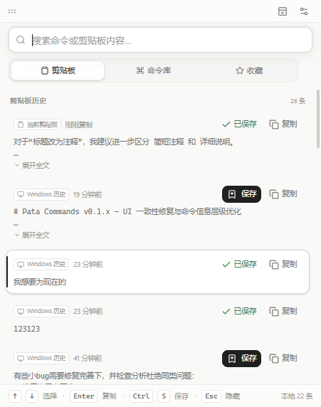

| 完整管理：三栏布局 | 快捷面板：命令库 |
| --- | --- |
| 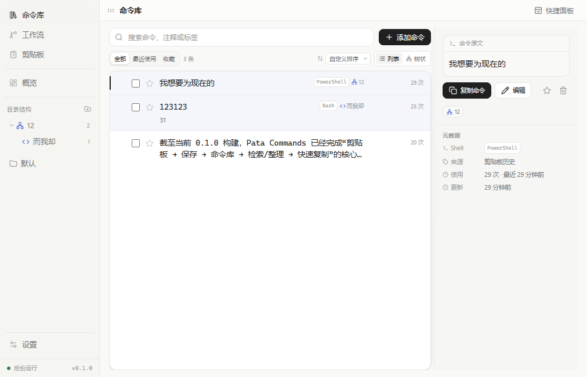 | 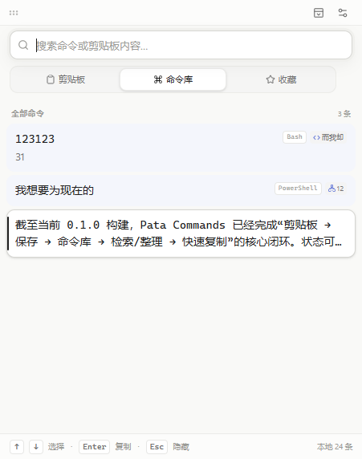 |

| 命令详情 | 深色三栏 |
| --- | --- |
|  | 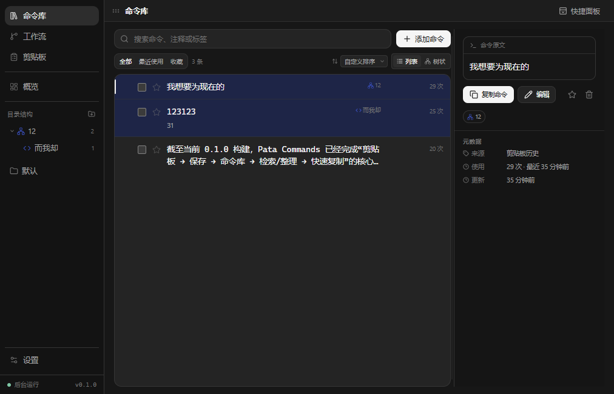 |

| 管理器剪贴板 | 命令编辑器 |
| --- | --- |
|  | 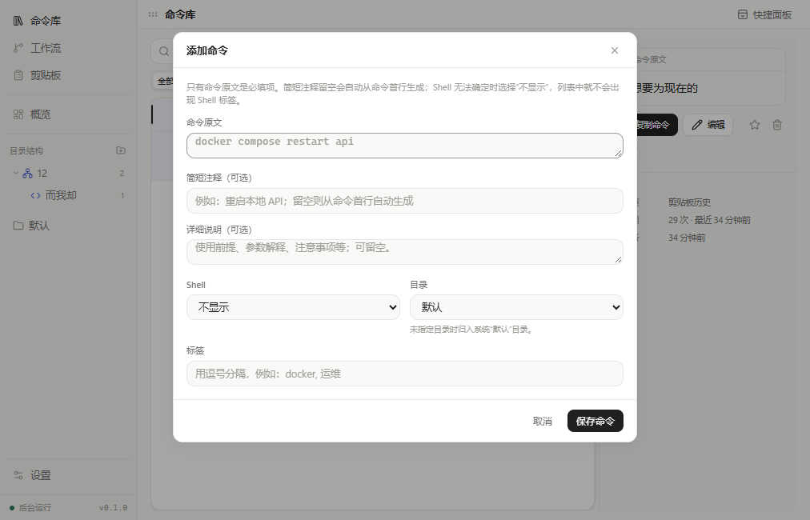 |

| 快捷搜索：单一清空 | 长命令详情 |
| --- | --- |
| 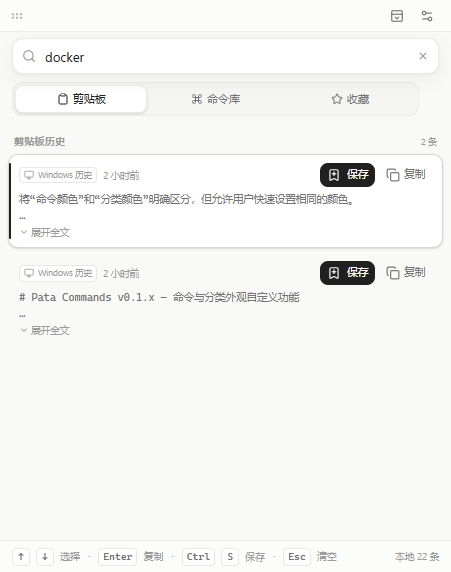 | 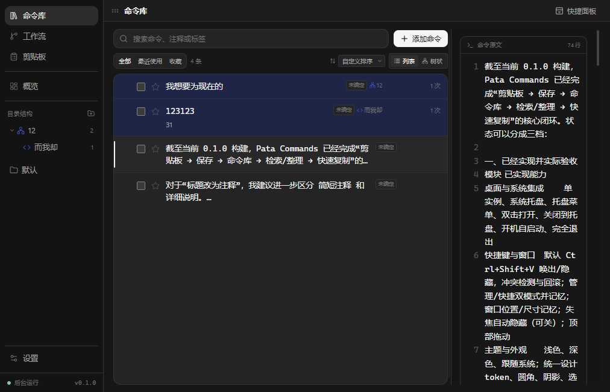 |

| AI 配置 | 单条生成预览 |
| --- | --- |
| 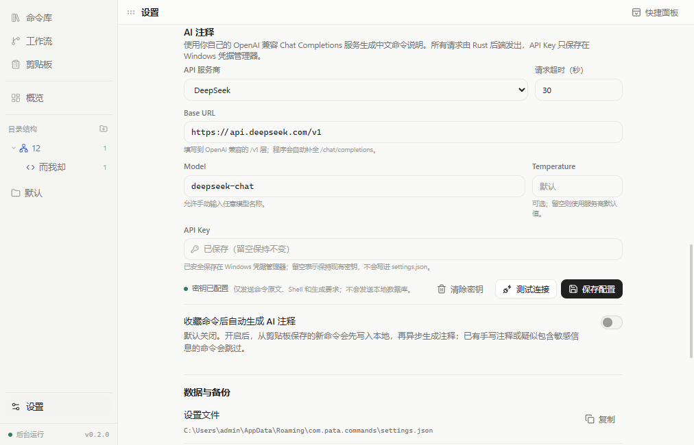 | 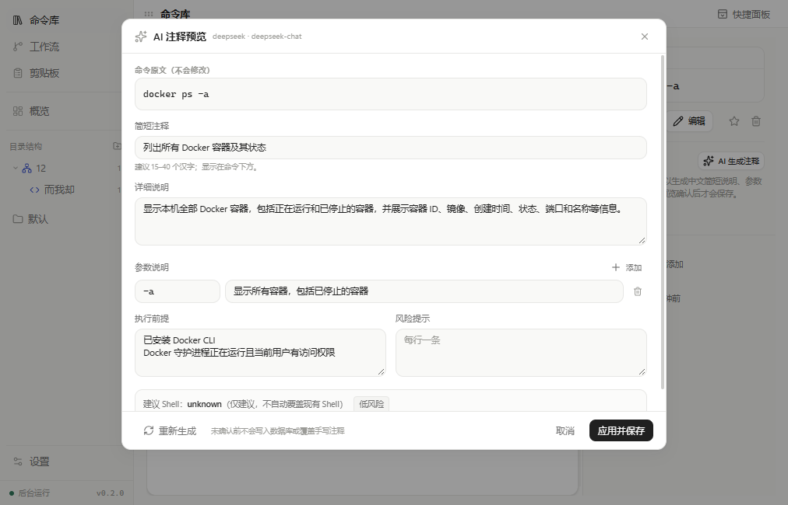 |

| 快捷面板 AI 简短注释 | 批量生成（仅无注释） |
| --- | --- |
| 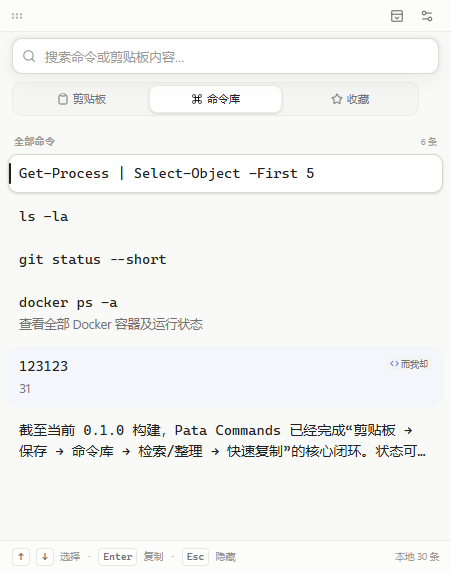 | 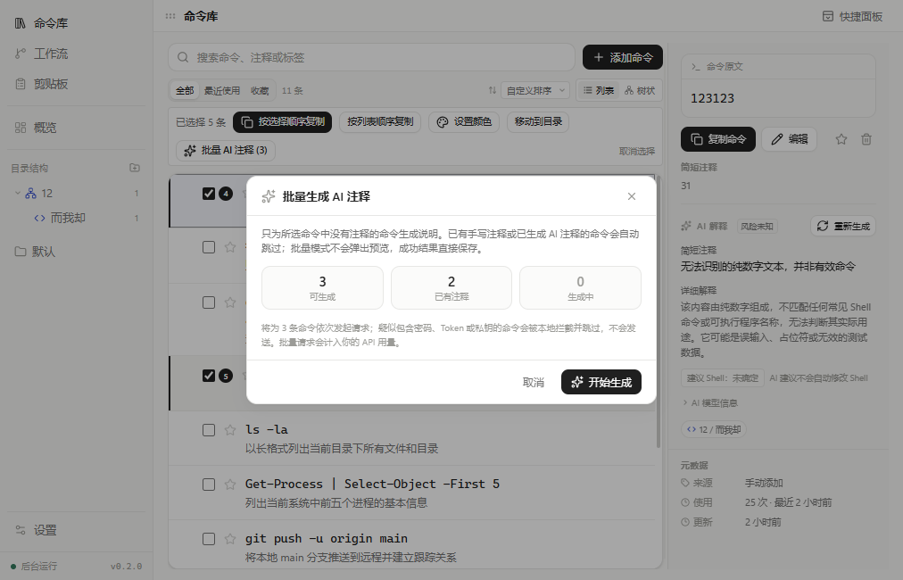 |

> 截图来自实际运行的 Windows 桌面程序（WebView2 截图，不含系统标题栏）。截图中的命令和剪贴板历史是验收测试数据，写入真实 SQLite，不是前端硬编码；交付前已清理应用数据库中的测试命令、本地历史和备份，用户原有命令保留。Windows 系统剪贴板历史属于测试机器，应用不会修改它。

## 当前完成

- **阶段一：Tauri 桌面基础、托盘、快捷键、窗口、主题**
- **紧凑 UI：460×480 快捷面板、900×650 管理窗口**
- **阶段二：SQLite 命令库、分类/标签、搜索、排序、JSON、备份恢复**
- **阶段三：剪贴板驱动快速收藏**
  - 当前 Windows 剪贴板读取；
  - 官方 WinRT 系统剪贴板历史；
  - `AddClipboardFormatListener` 本地监听；
  - 一键保存、自动标题/Shell、精确去重、来源字段；
  - 敏感内容过滤与保存确认；
  - 快捷面板三视图与键盘操作；
  - 设置、清理和真实管理器剪贴板页。
- **阶段三后续增量：命令库交互、排序与分类树**
  - 自定义/最近/名称排序，拖拽排序持久化；
  - Ctrl/Shift 多选、选择序号、按选择/列表顺序复制；
  - 命令右键菜单（快捷面板与管理器共享）；
  - 移动到分类、拖放分类、600 ms 自动展开与撤销；
  - 列表/树状视图、分类右键新建/重命名/删除/上移下移；
  - 删除分类时显式处理命令与子分类，永久命令不级联删除。
- **阶段三后续增量二：命令整理体验修复**
  - 修复 Windows 上 Tauri 默认拖放处理器导致的红色禁止光标；
  - 快捷/管理器菜单按窗口区分，管理器增加真实上移/下移；
  - 修复原生拖拽到分类、插入线和自动展开；
  - 拖拽缩略图、多选数量、Esc 页面级取消保护；
  - 快捷卡片显示直接分类，悬停显示完整路径；
  - 移动到分类面板就地新建一级/嵌套分类，支持“创建并移动”；
  - 分类重名、空名称和深层嵌套统一校验。
- **UI/UX 整体改版**
  - 统一圆角、阴影、间距、选中态和弱标签设计 token；
  - 快捷面板改为 Raycast 式紧凑搜索、分段标签和结果行，仍保持 460×480；
  - 完整管理界面为分类树 / 命令列表 / 详情预览三栏；
  - 右侧 Pieces 式代码详情、元数据和快捷操作；
  - 列表/详情分隔线可拖动，宽度持久化；窄窗口自动收起详情；
  - 浅色/深色同步更新，保留现有菜单、拖拽、排序和快捷键。
- **命令与分类外观**
  - 命令背景颜色、马卡龙预设、调色盘、HEX 和个人色板；
  - “使用所在分类颜色”实时模式，与命令自己的颜色分开；
  - 分类 Lucide 图标和图标颜色，全界面统一；
  - 多选批量设置颜色；深色主题自动适配；
  - 外观字段随数据库 v3 引入；当前数据库 v5、设置 schema 5，JSON schema 4 兼容旧数据。
- **UI 一致性与命令优先层级**
  - 搜索框只保留一个清除按钮，Esc 先清空再隐藏；
  - 管理器剪贴板补齐保存、复制、搜索和已保存状态；
  - 快捷面板/管理器删除重复品牌与多层级标题，界面更紧凑；
  - “分类/未分类”统一显示为“目录结构/默认”，内部数据不变；
  - 命令原文优先，简短注释在下，详细说明只在详情展示；
  - 共享 `CommandPrimary` 用于快捷面板、列表、树和拖拽预览；
  - 未知/空 Shell 不显示标签，明确的 Shell 使用统一 `ShellBadge`；
  - 字号与长命令阅读优化，详情单一滚动条；
  - 修正高饱和自定义色在深色主题下的刺眼问题。
- **AI 智能注释（v0.2.0）**
  - OpenAI 兼容 Chat Completions 配置：服务商预设/自定义、Base URL、Model、Timeout、可选 Temperature；
  - API Key 只存 Windows Credential Manager，不进入 settings.json、SQLite、JSON 导出或日志；
  - 测试连接、单条生成、生成中状态、取消、错误提示和重新生成；
  - 结构化中文结果：简短说明、详细解释、参数、前提、风险、Shell 建议；
  - 预览中可编辑、重新生成、取消；确认后才写入独立 `ai_annotations` 表；
  - 手写注释提供保留（默认）、追加、替换三种处理；未确认不会覆盖；
  - 收藏后自动注释默认关闭；异步执行、不阻塞保存，敏感/手写/已有注释命令跳过；
  - 多选批量生成仅处理没有注释的命令，已有注释自动跳过并显示统计；
  - 命令内容哈希变化后提示 AI 注释可能过期；数据库备份恢复保留 AI 注释。

- **提示词库（v0.2.0 增量）**
  - 独立 `Prompt` 实体、提示词目录树、标签、收藏、背景颜色、排序、使用次数和软删除；
  - 数据库 v5 增量迁移，新增 `prompts` / `prompt_categories` / `prompt_tags` / `prompts_fts`，不改已有命令数据；
  - 提示词库三栏：目录树 / 文本卡片列表 / 完整原文预览；长文本自动换行、可选择、可滚动；
  - 简洁多行文本编辑器：标题可选、正文必填、Ctrl+S 保存、Esc 取消、未保存确认、原生撤销重做；
  - 快捷面板两级导航（剪贴板 / 命令库 / 提示词库 + 全部 / 最近使用 / 收藏），提示词 5 行预览、展开全文、右键菜单；
  - 剪贴板保存按钮保留下拉菜单：一键保存为命令不变，另可保存为提示词；
  - 中文全文搜索、标签/目录/收藏筛选、批量复制、拖拽排序和拖到目录；
  - 提示词库不调用 AI、不显示 Shell/执行风险/终端环境/行号；
  - JSON schema 4 导入导出和数据库备份恢复同时包含命令与提示词；旧 schema 1–3 导入不会删除提示词库。
- **在线更新（v0.2.0 增量）**
  - Tauri v2 Updater + NSIS 签名更新包；
  - 启动 4 秒后静默检查一次，有新版本弹出更新说明；设置页可手动检查；
  - 显示下载进度、大小和更新内容，下载完成后运行 NSIS 安装并自动重启；
  - 更新包使用 minisign 公钥校验，私钥只保存在本机 `src-tauri/updater-keys/`（已 gitignore）；
  - 更新保留命令、提示词、设置、备份和凭据；
  - 更新源已指向 `https://github.com/605521553/cmdLoad/releases/latest/download/latest.json`，发布新版本时执行 `npm run release` 并上传生成的资产即可。
  - 详见 [在线更新说明](docs/updater.md)。

工作流仍未实现；导航中继续显示明确的占位说明。

## 阶段三亮点

### 剪贴板历史 ≠ 命令库 ≠ Favorite

- **当前剪贴板**：实时 Win32 读取，不自动入库。
- **Windows 系统历史**：WinRT 只读读取，不修改/删除。
- **本地监听历史**：独立 `clipboard_entries` 表，最多 100 条 / 默认 7 天，可关闭、可清空。
- **永久命令库**：只有用户点击保存才写入 `commands`。
- **Favorite**：命令库中的独立标记；保存不等于收藏。

### 一键保存

- 不要求标题、说明、Shell、分类或标签。
- 自动标题：首个有意义行，最多 80 字；自动 Shell：仅明确特征猜测，否则 `unknown`。
- 未分类、空标签、空说明；保存后可手动编辑。
- 严格按原文去重；保留原始空白、CRLF、缩进、引号和中文。
- 保存成功立即显示“已保存”，不关闭快捷面板，可连续收藏。
- 已保存项可跳转命令编辑器，并可单独设置 Favorite。

### Windows 系统历史

- 使用官方 `Windows.ApplicationModel.DataTransfer.Clipboard`：
  - `IsHistoryEnabled()`
  - `GetHistoryItemsAsync()`
  - `DataPackageView.GetTextAsync()`
- 保留系统顺序，过滤不可读格式，跨来源按原文去重。
- 系统历史关闭时显示提示，当前剪贴板和本地历史仍可用。
- 未使用 Win+V 模拟、截图识别或未公开数据库；不修改 Windows 历史。
- 当前未订阅 `HistoryChanged`，通过面板打开/剪贴板更新/保存清空事件刷新。

### 本地监听

- 使用 `AddClipboardFormatListener` + `WM_CLIPBOARDUPDATE`，专用 message-only 窗口和后台工作线程。
- 连续复制合并处理；相同内容更新时间不重复插入。
- 应用自身复制使用 1.5 秒抑制窗，避免监听回环。
- 敏感文本不进入本地历史；空文本、图片、超长文本跳过。
- 支持数量/期限清理、监听开关和一键清空。

### 敏感内容

- 识别私钥、password/passwd、Token/API Key、Bearer、AWS、带凭据连接串等明显模式。
- 敏感系统历史条目标记“敏感”；保存前二次确认，取消不写库。
- 本地监听不缓存敏感内容；AI 自动/批量路径也不会发送敏感命令，手动生成需二次确认。

## 本轮命令库交互增量

- **排序**：列表拖拽有插入指示线，前端乐观更新，Rust 单事务写入；失败恢复。只有自定义排序允许排序拖动，最近/名称排序仍可拖到分类。
- **多选**：Ctrl 切换、Shift 范围选择、序号与点击顺序一致；底部支持按选择顺序复制、按列表顺序复制、移动分类和清空。
- **右键菜单**：复制、编辑、收藏、移动、在管理中查看、删除；快捷面板支持鼠标右键和 `Menu`/`Shift+F10`，菜单自动避让窗口边缘。
- **分类移动**：右键/多选对话框/拖到侧栏/拖到树分类共用同一后端接口；批量单事务，成功后可撤销。
- **树状视图**：分类层级、命令、未分类、数量、展开状态记忆；命令可分类内排序或拖到其他分类。
- **分类删除**：明确选择直接命令去父级或未分类，子分类提升或删除子树；永久命令只改分类，不级联删除。

## 命令与分类外观

- **命令背景颜色**：8 个浅色马卡龙预设、系统调色盘、HEX 输入和实时预览；管理器和快捷面板同步显示。
- **跟随分类颜色**：命令自己的颜色与分类颜色分开保存；“使用所在分类颜色”是实时模式，分类改色后自动同步，关闭后恢复自己的颜色。
- **个人色板**：自定义颜色可保存到“我的颜色”，命令和分类面板共享；去重、可排序、可删除，删除不影响已设置外观。
- **分类图标**：26 个 Lucide 图标，可按英文名/中文名/关键词搜索；分类颜色只作用于图标。
- **全局一致**：侧栏、树状视图、移动分类、分类管理器、命令详情和快捷面板共用同一分类图标/颜色。
- **浅色/深色**：预设和自定义色自动派生低亮度深色背景/图标色，文字保持可读；颜色设置与个人色板重启后保留。
- **批量**：管理器多选后可一次设置全部选中命令的颜色，单事务写入。

## 原有能力

- 命令新增、编辑、软删除、收藏、最近使用、使用次数。
- 提示词新增、编辑、软删除、收藏、最近使用、使用次数；提示词目录独立。
- 分类树、标签自动创建、命令/提示词拖拽排序、多选复制。
- 命令与提示词分别维护 FTS5 + 中文/子串 LIKE 回退搜索；全部/最近/收藏/分类/标签。
- 快捷面板 `↑/↓`、`Enter` 复制、`Ctrl+S` 保存、`Esc` 隐藏/收起展开的提示词。
- 只有系统剪贴板写入成功后才记录命令或提示词使用次数。
- JSON schema 4 导入导出，兼容 schema 1/2/3；合并/完整恢复、导入前备份，保留颜色和图标。
- 数据库 `VACUUM INTO` 备份、恢复前备份、事务恢复；数据库备份恢复包含提示词与 AI 注释。
- AI 注释：独立表、结构校验、生成预览、自动/批量、哈希过期检测和模型信息展示。
- 托盘、单实例、全局快捷键、窗口位置记忆、失焦隐藏、开机自启动、浅/深色主题。

## 技术栈

| 层级 | 技术 |
| --- | --- |
| 桌面框架 | Tauri 2 |
| 前端 | React 19 + TypeScript 5.9 + Vite 7 |
| 样式 | Tailwind CSS 4 |
| 状态 | Zustand |
| 后端 | Rust 2021 |
| 数据库 | SQLite（rusqlite bundled）、FTS5、WAL、外键 |
| Windows API | Win32 剪贴板/窗口；WinRT 剪贴板历史；Credential Manager |
| AI 网络 | Rust reqwest（OpenAI 兼容 Chat Completions，Windows 原生 TLS） |
| 后续 | 工作流 |

依赖版本由 `package-lock.json` 与 `src-tauri/Cargo.lock` 固定。

## 环境要求

- Windows 10 / 11（64 位）。系统剪贴板历史需要 Windows 10 1809+ 且用户开启该功能；本项目只在 Windows 11 实测。
- Node.js >= 22.12（验证：24.21.0）
- npm >= 10（验证：11.19.0）
- Rust stable >= 1.90（验证：1.99.1，MSVC）
- Visual Studio 2022 Build Tools（Desktop development with C++、Windows SDK）
- WebView2 Runtime（Windows 11 通常已内置）

## 开发与构建

```powershell
npm ci
npm run tauri dev
```

生产构建（签名安装包 + 更新清单）：

```powershell
npm run release
```

`npm run release` 会读取 `src-tauri/updater-keys/` 的签名密钥，构建 NSIS 安装包和 `latest.json`。只构建不签名可使用：

```powershell
$env:TAURI_SIGNING_PRIVATE_KEY = "src-tauri/updater-keys/pata-commands.key"
$env:TAURI_SIGNING_PRIVATE_KEY_PASSWORD = "..."
npm run tauri build
```

最终产物：

- Release 可执行文件：`src-tauri/target/release/pata-commands.exe`
- NSIS 安装包：`src-tauri/target/release/bundle/nsis/Pata Commands_0.2.0_x64-setup.exe`
- 更新包与清单：`artifacts/updater/latest.json`、`Pata Commands_0.2.0_x64-setup.exe`、`.exe.sig`
- 具体大小与 SHA-256 见 [构建产物](#构建产物)。
- 在线更新发布流程见 [在线更新](docs/updater.md)。

安装包未配置代码签名证书，Windows SmartScreen 可能提示“未知发布者”。

## 质量检查

```powershell
npm run typecheck
npm run lint
npm run test
npm run build
cargo fmt --manifest-path src-tauri/Cargo.toml -- --check
cargo clippy --manifest-path src-tauri/Cargo.toml --all-targets -- -D warnings
cargo test --manifest-path src-tauri/Cargo.toml
```

完整实际测试结果见 [测试记录](docs/testing.md)。

质量门禁：

- `npm run check`：TypeScript strict、ESLint、154 个 Vitest 测试、生产 Vite 构建通过。
- rustfmt、Clippy `-D warnings`、116 个 Rust 测试通过。
- 实际 Windows 桌面：快捷面板 460×480、管理三栏、浅深色、详情操作、详情宽度拖动和重启保持完成验收；全局快捷键唤出/隐藏、上移/下移、原生拖拽排序、拖到分类、自动展开、多选拖动、快捷分类路径、分类就地创建与重名校验继续通过。
- AI：真实 DeepSeek API 测试连接、单条生成/编辑/重新生成、自动 pending→ready、批量 3/3、取消、失败保留、过期检测、敏感确认和重启持久化完成实际验收。
- Release 与 NSIS 安装包完成安装、启动、快捷面板/管理尺寸和卸载复验（最终数据见测试记录）。

## 使用提示

- 默认快捷键 `Ctrl+Shift+V`，可在设置中重新录入。
- 从终端复制文本后唤出快捷面板，「剪贴板」页顶部是当前内容；点击“保存”即可收藏，无需表单。
- 在历史项上可以“保存”或“复制”；「已保存」可打开命令编辑器，继续设置标题、Shell 或 Favorite。
- 快捷面板中：
  - `↑` / `↓` 选择；
  - `Enter` 复制；
  - `Ctrl+S` 保存选中剪贴板项；
  - `Esc` 隐藏。
- 搜索框会过滤当前视图；切到「命令库」或「提示词库」时使用各自后端的权威搜索。
- 快捷面板顶部两层：内容类型「剪贴板 / 命令库 / 提示词库」，以及「全部 / 最近使用 / 收藏」筛选。
- 提示词卡片默认显示约 5 行原文；点“展开”在当前面板内滚动查看全文，`Esc` 先收起再清空搜索/隐藏。单击复制完整原文，右键可编辑、收藏、移动、删除或在完整提示词库中查看。
- 剪贴板条目“保存”旁的下拉菜单可在“保存为命令”和“保存为提示词”之间选择；主按钮的一键保存为命令保持不变。
- 提示词库为目录树 / 提示词列表 / 完整原文预览三栏；单击选中，双击复制，底部可批量复制、移动或设置背景颜色。
- 提示词编辑器支持多行纯文本、Markdown 和代码块；标题、目录、标签、颜色可选。`Ctrl+S` 保存，`Esc` 取消，有未保存修改时会二次确认。
- 提示词目录在侧栏中独立于命令目录；切换「命令库」/「提示词库」时只显示当前库的目录。目录右键支持新建子目录、重命名、外观、上移/下移和删除。
- 命令库/收藏卡片右键可编辑、收藏、移动、查看或删除；快捷面板也可按 `Menu` 或 `Shift+F10`。
- 管理器右键菜单另有上移/下移，仅在自定义排序启用；快捷面板保留“在完整管理界面中查看”，管理器不显示该项。
- 命令有多选时，卡片左侧显示 1/2/3 选择顺序；底部可分别按选择顺序或列表顺序复制。
- 完整管理界面为分类树 / 命令列表 / 详情三栏；悬停命令即可在右侧查看代码和元数据。
- 拖动列表与详情之间的分隔线可调整详情宽度，双击恢复默认；窗口较窄时详情自动收起。
- 命令库顶部可切换自定义/最近/名称排序与列表/树状视图；只有自定义排序允许拖动和上移/下移。
- 拖动命令时显示标题、单行预览和选择数量；命令行间有插入线，左侧分类高亮；停留约 600 ms 会自动展开折叠分类。
- 拖拽由 WebView2 原生 HTML5 DnD 处理：Tauri 的默认拖放 handler 已关闭，避免 Windows 上出现红色禁止光标。
- 拖动命令到左侧分类或未分类入口可移动；移动后通知提供「撤销」。
- 快捷卡片右侧显示直接分类，悬停可看完整路径（如 `Linux / Docker`）；未分类不显示。
- “移动到分类”面板底部固定“新建一级分类”，每个分类行可新建子分类；输入名称后按 Enter 或点“创建并移动”，Esc 取消。
- 树状视图中分类可右键新建子分类、重命名、上移/下移或删除；删除时必须选择命令去向和子分类处理。
- 手动添加保留在命令库「添加命令」；只有命令原文必填。
- 设置 → 剪贴板可关闭监听、修改缓存上限/保留期限、清空本地历史、查看 Windows 系统历史状态。
- 关闭窗口只是隐藏；完全退出使用托盘或设置底部按钮。

## 数据位置

```text
%APPDATA%\com.pata.commands\settings.json       # 设置 schema 5
%APPDATA%\com.pata.commands\commands.db         # SQLite schema 5（命令 + 提示词）
%APPDATA%\com.pata.commands\backups\            # 数据库备份
%USERPROFILE%\Downloads\pata-commands-export-<timestamp>.json
```

- 设置文件包含窗口、主题、快捷键、自启动、剪贴板偏好和 AI 非敏感配置；不包含命令、提示词、剪贴板内容或 API Key。
- API Key 只保存在 Windows Credential Manager 的 `PataCommands/AI/OpenAICompatible`。
- `commands.db` 包含命令、分类、标签、提示词、提示词目录、本地临时剪贴板历史和独立 `ai_annotations` 表，均为本机明文；AI 注释与提示词随数据库备份恢复。
- Windows 系统剪贴板历史不写入数据库；只在读取时进入内存并显示。
- 数据库备份包含本地剪贴板历史、提示词和 AI 注释；JSON 导出包含命令、提示词、目录、标签和外观，不包含 AI 注释或 API Key。
- AI 请求只发送当前命令原文、Shell 和生成要求到你配置的 OpenAI 兼容服务；提示词不会被发送；没有云同步。

## 项目结构

```text
src/
├── app/                 # 双模式应用入口
├── components/          # 通用 UI、品牌、反馈
├── features/
│   ├── ai/              # 生成预览、敏感确认、批量生成
│   ├── prompts/         # 提示词库、编辑器、预览、颜色、右键菜单
│   ├── quick-panel/     # 剪贴板/命令库/提示词库、保存/复制
│   ├── command-manager/ # 命令库、编辑器、分类树、详情 AI 区块
│   └── settings/        # 设置、AI 配置、剪贴板配置、数据工具
├── hooks/               # Tauri 事件、主题、拖动、防抖
├── services/            # IPC 封装
├── stores/              # 模式、路由、事件 revision
├── types/               # TypeScript 契约
└── utils/               # 错误、热键、时间、样式

src-tauri/src/
├── commands/            # app/window/settings/library/prompts/clipboard/ai
├── models/              # settings/command/prompt/clipboard/ai DTO
├── services/
│   ├── ai/              # 请求、prompt、凭据管理器、注释持久化
│   ├── database/        # SQLite、迁移、完整性
│   ├── library/         # 命令 Repository/Service、导入导出、备份
│   ├── prompts/         # 提示词 Repository/Service（独立表）
│   ├── clipboard/       # 当前读取、WinRT 历史、监听、临时历史
│   ├── settings/        # 设置 JSON
│   ├── hotkey/ autostart/ tray/ window/
├── state.rs             # 共享状态、data/prompt/clipboard revision、AI 取消表
├── error.rs             # 可序列化错误
└── lib.rs               # 启动与生命周期
```

## 文档

- [架构设计](docs/architecture.md)
- [功能清单](docs/feature-list.md)
- [实施计划](docs/implementation-plan.md)
- [开发进度](docs/development-progress.md)
- [测试记录](docs/testing.md)
- [数据库设计](docs/database-schema.md)
- [在线更新](docs/updater.md)

## 已知限制

- 单 WebView 单窗口；管理/快捷面板互斥。没有两个物理 WebView 同时显示。
- Windows 系统历史依赖系统版本和用户开启；当前只在 Windows 11 实测，`access_denied` 分支未强制模拟。
- 未订阅 `Clipboard.HistoryChanged`；通过面板打开和剪贴板更新刷新。
- 敏感识别是启发式，可能误报/漏报；本地历史以明文保存在 SQLite，未加密。
- 自身复制抑制为 1.5 秒时间窗。
- 系统历史中的敏感文本仍会显示（只读），保存前需确认；没有自定义排除规则。
- 分类节点拖动排序、跨分类精确插入、独立标签管理、回收站、列表分页、原生另存为未实现。
- 提示词目录排序沿用现有目录右键“上移/下移”和同级顺序持久化；提示词卡片支持拖拽排序和拖到目录，目录节点本身暂不支持拖动。
- 提示词 Markdown 文件导出未实现；JSON 导入导出和数据库备份已包含提示词。
- 分类外观每级独立，不支持继承；分类图标限于内置 Lucide 集合，不支持上传 SVG/图片。
- 个人色板保存在 `settings.json`，不进入数据库备份或命令 JSON。
- 命令详情提供等宽代码、行号、选择、复制和注释行弱化，没有引入完整语法高亮库。
- 管理器剪贴板页展示当前剪贴板和本地历史；Windows 系统历史仍只在快捷面板只读展示。
- “默认”是系统空分类的显示名；用户自建同名目录内部仍用不同 ID 区分，当前没有额外“系统”徽标。
- 命令编辑器的外观颜色仍通过右键颜色面板设置；125%/150% DPI 多显示器未做逐像素矩阵。
- Shell 隐藏只改变前端显示，数据库 `shell` 原值保留；编辑器选择 `unknown` 时选项显示为“不显示”。
- Tauri 原生文件拖放已关闭（`dragDropEnabled: false`），这是 Windows 上使用 HTML5 拖放的必需配置；文件导入仍走文件选择器。
- AI 注释的 JSON 导出尚未包含 `ai_annotations` 表；数据库备份恢复包含。批量生成由前端逐条驱动，退出应用会中止当前批次；自动请求没有单独停止按钮。
- 工作流、云同步和代码签名未实现；在线更新已接入，endpoint 指向 `605521553/cmdLoad` 的 GitHub Releases。首次安装必须使用包含 updater 的构建；未签名安装包仍可能触发 SmartScreen。
- 多显示器/非 100% DPI 只有算法单测。
- 旧 schema 数据库备份不能直接恢复（当前只接受 v5）；JSON schema 1–4 可以导入；数据库 v5 / 设置 schema 5。

## 构建产物

- Release 可执行文件：`src-tauri/target/release/pata-commands.exe`，7,098,368 bytes
  - SHA-256：`8ECD2C6254DC417FD071E8E014146EFA0586D2C37C7D01078E72AA167C7A095C`
- NSIS 安装包：`src-tauri/target/release/bundle/nsis/Pata Commands_0.2.0_x64-setup.exe`，2,899,290 bytes
  - SHA-256：`B1FC3337EC380E7930844F15DC98F7CD5AFC89B6A53E7BFC8907ABB2B15802F6`
  - 更新签名：`Pata Commands_0.2.0_x64-setup.exe.sig`
- 更新清单：`artifacts/updater/latest.json`（指向 `605521553/cmdLoad` Releases）
- 生产前端资源（Tauri release）：JS 594.87 kB（gzip 178.24 kB）、CSS 51.64 kB（gzip 9.70 kB）。
- 本轮 Release 与 NSIS 安装包已重新构建；Release 实际启动、数据库 v4 → v5 迁移、快捷面板保存提示词和管理器提示词页完成交互验收。安装包的静默安装/卸载复验沿用上一轮记录，本轮未重复执行。

安装包未配置代码签名证书，Windows SmartScreen 可能提示“未知发布者”。
